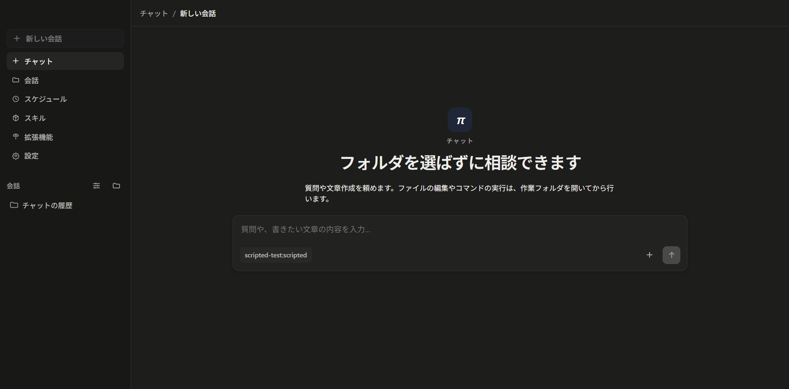
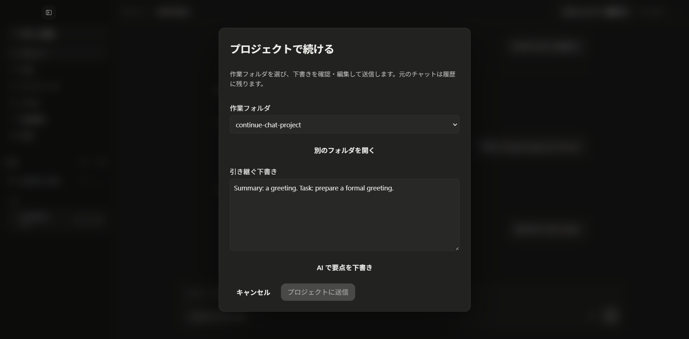

# pi-gui-ja-base — 日本語で使い、改造するための土台

[pi-gui](https://github.com/minghinmatthewlam/pi-gui) をもとに、日本語で使い、自分の用途に合わせて改造するためのベースを開発しています。日本語UI、フォルダ不要の相談からプロジェクトへの引き継ぎ、Windows の端末内音声入力を重点に整備しています。エージェントの実行には [Pi](https://github.com/earendil-works/pi) を使います。

[](./LICENSE)

**開発中の非公式フォークです。** この README は2026年11月26日時点のソースと検証記録を説明します。ソース公開先は [このリポジトリ](https://github.com/shijun537/pi-gui-ja-base) です。正式な Windows 配布版の完成を示すものではありません。

上流版の Releases と公式サイトは、上流版の案内です。このフォークの追加機能を含む配布先ではありません。Windows 配布アプリの正式名、識別子、署名方式は未決定です。

紹介サイトは [こちら](https://shijun537.github.io/pi-gui-ja-base/) です。

紹介ページのソースは [apps/website](apps/website) にあります。日本語UIと改造の入口を重視する方針、確認済みの機能、未完了の検証を掲載しています。他のGUIにない機能だと断定するものではありません。Web への公開状態は [紹介ページの実行記録](docs/development/website-publication-plan.md) を参照してください。

[利用条件・免責](docs/legal/terms.md) · [プライバシー](docs/legal/privacy.md) · [ライセンス・謝辞](docs/legal/licenses.md) · [セキュリティ](SECURITY.md) · [サポート](docs/support.md) · [検証の引き継ぎ](docs/development/validation-handoff.md)

## スクリーンショット

このフォークを Windows の実 Electron で動かした画面です。2026年11月20日の検証時に、合成モデルと一時プロファイルで撮影しました。モデル名・フォルダ名・下書きは試験用です。開発中のため、現在のソースとは表示が一部異なる場合があります。

### フォルダを選ばずに相談

日本語のサイドバーとチャット画面。作業フォルダを決める前に、質問や文章作成の相談を始められます。



### 相談をプロジェクトへ引き継ぐ

作業フォルダを選び、引き継ぐ下書きを確認・編集してから送信できます。元のチャットは履歴に残ります。



[画像の撮影条件と確認範囲](docs/screenshots/README.md)

## 追加した機能と検証範囲

以下の「実装済み」は現在の作業ツリーにあることを示します。公開済みのリリースへの収録を意味しません。「試作」は専用の検証コピーなどでの結果で、通常のアプリにはまだ組み込まれていません。

| 項目                                   | 実装・検証できた範囲                                                                                                                           | 残る確認・制約                                                                                     |
| -------------------------------------- | ---------------------------------------------------------------------------------------------------------------------------------------------- | -------------------------------------------------------------------------------------------------- |
| 日本語表示                             | 主要な会話画面、設定、レビュー、右ペイン、Windows メニューなどを実装し、Windows の実 Electron で対象操作を確認                                 | 外部サービスの原文、モデル名、ファイル名、Windows が管理する標準画面まで翻訳するものではありません |
| フォルダ不要のチャット                 | ローカルの合成モデルで送信・停止・再起動後の再開、ツールを提示しないことを確認                                                                 | 実サービスのモデルを使った同条件の確認は未実施                                                     |
| プロジェクトで続ける                   | 要点の下書き、編集後の送信、取消、元の履歴の保持を合成モデルで確認                                                                             | フォルダ選択の自動試験は選択結果の差し替えを使用。実サービスでの確認は未実施                       |
| 添付・モデル選択・ピン留め・フォルダ色 | 対象操作、下書きの保持、設定の再読込などを Windows の実 Electron で確認                                                                        | OS のクリップボードを含む貼り付け全体の確認とは別です                                              |
| プロジェクトの承認                     | 「読むだけ」「確認して作業」を実装し、合成モデルで編集・コマンドの許可と拒否を確認                                                             | 選択は再起動後に適用。OS の隔離機能ではありません                                                  |
| Windows 音声入力                       | Whisper `large-v3`、日本語指定、Vulkan と CPU への復帰を実装。展開候補で合成音声のオフライン文字起こしと下書き保持を確認。実マイクの認識も確認 | 実マイクの待ち時間、最低動作スペック、幅広い機器での精度は未確定。`turbo` は比較段階               |
| モデル一覧取得の転送防止               | 登録先からのリダイレクトを拒否し、ローカル試験で転送先への要求が0件であることを確認                                                            | 会話など全経路の送信先照合が製品実装されたことを意味しません                                       |

## 試作・候補の状態と既知の問題

| 項目                       | 確認したこと                                                                                                                              | 未完了のこと                                                                                                                 |
| -------------------------- | ----------------------------------------------------------------------------------------------------------------------------------------- | ---------------------------------------------------------------------------------------------------------------------------- |
| API キーの送信先照合       | 非公開ビルドで、保護を有効にした OpenAI 互換 HTTP(S) 接続先について会話・タイトル・引き継ぎ下書きを確認。拡張や仮想モデルによる変更も試験 | 製品への取り込みは未決定。任意のプロバイダーや通信方式を保護する保証はありません                                             |
| API キーの暗号化と設定画面 | 独立した Windows 試作で暗号化、再起動後の保持、画面にキーを返さない操作を確認                                                             | 製品実装、既存キーの扱い、OAuth やコマンド参照との互換性が残っています                                                       |
| Windows の隔離             | MXC を検討対象として記録                                                                                                                  | 未導入。同じ Windows ユーザーの別アプリ、拡張、子プロセスからキーを隔離できるとは案内していません。システムプロキシも未検証  |
| Electron 更新              | `44.11.6` の専用候補で起動、日本語設定、端末、音声入力を確認。非同期クリップボード API への修正も試験                                     | 現行ソースの設定は `37.10.3`。44 系の取り込みは保留で、OS のクリップボードを使う画像・テキストの Ctrl+V が未確認             |
| アプリ更新                 | 非公開セットアップ版 `1.0.1 → 1.0.2` の更新とデータ保持を確認                                                                             | 公開版への組み込み、署名の受け入れ、ファイル置換中断からの復旧が残っています。ポータブル版は手動差し替えの方針               |
| セットアップ               | 専用候補でデスクトップショートカットの既定オフと、選択あり・なし・無人のインストールと起動を確認                                          | 選択ありのアンインストールでショートカットと登録が残存。ウイルスバスターのブロック記録もありますが、残存との因果関係は未確定 |
| 独立版の識別と保存先       | 専用候補で別の識別子、設定先、ライセンス同梱、ポータブル起動を確認                                                                        | 正式名と識別子は未決定。上流版との同居とアンインストールは最終構成で未検証                                                   |

未検証は動かないという判定ではなく、動作を確認する根拠がまだ足りない状態を表します。試作で成功した結果も、異なる版や配布物へそのまま適用しません。

## 検証環境と結果の読み方

主な追加機能の確認は Windows x64 の一台で行いました。記録上の環境は Windows 26H2（ビルド 26300.9974）、Ryzen 5 5600、RAM 約32 GiB、RTX 4060（8 GiB）です。最低動作環境ではありません。

- 会話の主な機能試験は、実 Electron と端末内の合成モデル、ダミーキー、一時プロファイルを使用しています。実サービスとの互換性や応答品質の保証とは区別します。
- Windows の `pnpm check` の成功記録があります。コマンドに含まれる静的検査・単体試験と、別途行う実 Electron・OS 操作・配布物の確認は区別します。公開対象の最終差分での確認はこれからです。
- 音声入力は、約7秒の合成音声で録音停止から下書き追記まで約5.3秒という記録があります。GPU のキャッシュが温まった候補での値で、初回実行、実マイク、別の PC の待ち時間を示しません。
- Ubuntu VM では、初期の日本語化など13ファイルを反映した構成の全体検査を確認しました。今回の全追加機能の Linux 動作確認ではありません。このフォークの macOS 向け変更は未検証です。

機能別の条件と経緯は [開発進捗](docs/development/progress.md) に記録しています。

### 今回の公開準備で確認できたこと

2026年11月26日の制限付き Windows 環境では、既存の依存関係を使ったデスクトップのビルドが成功しました。全体検査では試験用リンクの作成が拒否され、新しいフォルダへの依存関係の導入も同じ制約で停止しました。チャットと Windows メニューの再試験は、Electron が起動前に終了したため確認できていません。起動失敗の原因は未確定です。

AppImage 修正後の GitHub CI では、Ubuntu の新規固定依存導入と pnpm check、Windows のディレクトリ形式パッケージと同梱依存、macOS Core の全4分割と集約、Linux の AppImage・deb と既存の配布検査がすべて成功しました。一方、別実行の拡張リンク単体診断では、スレッド表示切替後の成功通知待ちが失敗しています。全体 CI の成功だけでこの不安定な挙動を解決済みとはしていません。正式な Windows 配布、実クリップボード、実マイクの待ち時間などの残検証も別に管理しています。 [修正後の CI](https://github.com/shijun537/pi-gui-ja-base/actions/runs/45758269282) · [未解決の単体診断](https://github.com/shijun537/pi-gui-ja-base/actions/runs/45758269461)

以前の Linux CI では、AppImage 作成時に同梱ライブラリと basename の GLIBC 不整合で停止しました。公式の修正版ツールセットとチェックサムを固定する最小変更後は、AppImage・deb 作成、同梱依存、既存の Linux 配布検査まで成功しています。Pi と Electron の版は変更していません。

これらを成功済みの検証には数えていません。過去の成功記録と今回の結果を区別し、新規環境での導入完了や今回の実アプリ確認を保証しない開発中のソースとして扱います。個別の結果と再開手順は [公開準備の実行記録](docs/development/oss-publication.md) を参照してください。

## 認証情報と保存先

通常のアプリに、試作段階のキー暗号化や送信先照合がすべて備わっているわけではありません。既存の Pi 認証・カスタム接続先では、キーが平文の設定に保存され、設定取得で画面側へ渡る経路が残っています。

独立した既定の保存先も候補段階です。開発時は Pi の既存設定を共有する可能性があるため、試す場合はアプリ用と Pi 用の両方に専用プロファイルを指定してください。プロジェクトの承認機能も、拡張や子プロセスの OS レベルでの隔離を提供するものではありません。

## Pi 本体の導入について

GUI の依存関係を導入すると Pi の SDK も入るため、GUI を使うだけなら CLI の別途導入は不要です。CLI を単独利用したい場合のインストール、認証、版の確認、専用プロファイルは [Pi と GUI の導入ガイド](docs/getting-started.md) に記載しています。現在の SDK は Pi 1.4.0 です。

## ソースから起動する

Node.js 22.19 以上と pnpm 10.25.0 を使います。`pnpm-lock.yaml` が依存関係の基準です。Windows のネイティブ依存のビルドには Visual Studio Build Tools などが必要になる場合があります。新しい環境での一式の再現確認は公開前の残件です。

リポジトリのルートで実行します。

```powershell
corepack pnpm install --frozen-lockfile
```

Windows PowerShell で、試験用の新しい保存先を指定して起動する例です。この指定は Pi の既存設定をコピーしません。

```powershell
$trialProfile = Join-Path ([System.IO.Path]::GetTempPath()) ([guid]::NewGuid().ToString())
$env:PI_APP_USER_DATA_DIR = Join-Path $trialProfile 'app'
$env:PI_CODING_AGENT_DIR = Join-Path $trialProfile 'agent'
corepack pnpm dev
```

この例では、保存先を指定した PowerShell を閉じると環境変数の指定は終了します。保存したデータは自動削除されません。同じ試験データを再開する場合は、同じ保存先を指定してください。

音声入力を試す場合は、Windows 上で Whisper 実行部を別途用意します。ビルドには C++ ツールと CMake、Vulkan 版には Vulkan SDK が必要です。ビルド時に Whisper のソース、音声入力の初回利用時に約3.1 GB のモデルを取得します。取得後の文字起こしは端末内で行います。会話として送信するときは、通常のモデル接続先にテキストが送られます。

```powershell
node apps/desktop/scripts/build-whisper-windows.mjs
```

Vulkan 版をビルドする場合は、先に `VULKAN_SDK` と `PI_APP_BUILD_WHISPER_VULKAN=1` を設定します。CPU 版は AVX2 対応が前提です。GPU と必要メモリの最低条件は未確定です。

## 残作業と担当別の再開

[担当01〜06の実行計画](docs/development/remaining-work-allocation.md) に、依存関係、今回の追加検証、次の着手条件をまとめています。各担当の文書には、そのまま渡せる再開プロンプトがあります。未確認の試作を製品実装や正式配布の合格として扱っていません。

## 開発と検証

```powershell
$validationProfile = Join-Path ([System.IO.Path]::GetTempPath()) ([guid]::NewGuid().ToString())
$env:PI_APP_USER_DATA_DIR = Join-Path $validationProfile 'app'
$env:PI_CODING_AGENT_DIR = Join-Path $validationProfile 'agent'
$env:PI_APP_REAL_AUTH = '0'
corepack pnpm check:identity
corepack pnpm check
corepack pnpm build
```

`check:identity` は作業ツリーの混入検査であり、Git 履歴、任意の文字列、配布物すべての安全性を保証するものではありません。`pnpm check` は実 Electron を起動しません。画面や OS 操作を変更した場合は、[デスクトップの検証手順](apps/desktop/README.md) に従って対象を確認してください。

実サービスのモデルを使う試験は利用料金が発生し得るため、通常の合成データ試験とは別に扱います。

| 場所                                                   | 内容                                                                                         |
| ------------------------------------------------------ | -------------------------------------------------------------------------------------------- |
| `apps/desktop`                                         | Electron の画面、メイン処理、IPC                                                             |
| `packages/pi-sdk-driver`                               | Pi との連携                                                                                  |
| `packages/catalogs`・`packages/session-driver`         | 一覧やセッションの共通処理・型                                                               |
| `packages/extension-ui`・`examples/desktop-extensions` | 拡張 UI と使用例                                                                             |
| `apps/website`・`video`                                | 日本語の紹介サイトと上流由来の紹介素材。過去の素材を本フォークの実画面として掲載していません |
| `docs`                                                 | 設計、検証記録、開発計画                                                                     |

[アーキテクチャ](docs/architecture.md) · [コントリビュート](CONTRIBUTING.md) · [OSS 公開と Windows 配布の計画](docs/development/windows-release-plan.md)

## 上流とライセンス

このフォークは Matthew Lam 氏による [pi-gui](https://github.com/minghinmatthewlam/pi-gui) と、[Pi](https://github.com/earendil-works/pi) および関連プロジェクトをもとにしています。上流版の機能・検証実績と、このフォークでの変更・検証実績は区別して記載します。

[MIT License](./LICENSE) © Matthew Lam。元の著作権表示とライセンス本文を保持します。Whisper など同梱する第三者ソフトウェアのライセンスも、配布対象に応じて保持します。
